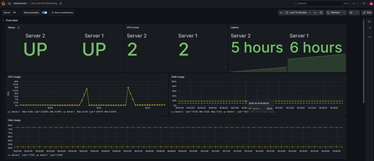
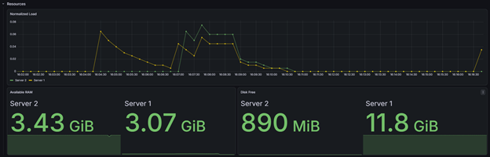
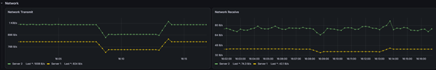
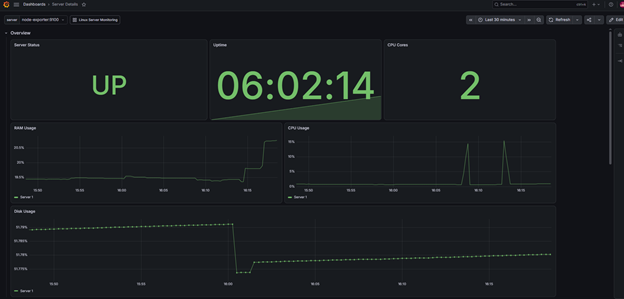
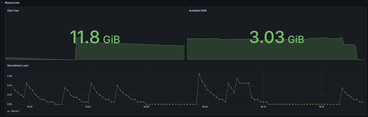
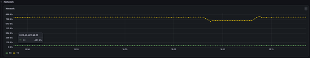

Linux Server Monitoring with Grafana and Prometheus

A hands-on infrastructure monitoring project that collects and visualizes Linux system metrics from two independent virtual machines.

Overview

This project demonstrates Linux server monitoring using Prometheus, Grafana, Node Exporter, and Docker Compose.

It includes dashboards for monitoring system resources, PromQL queries, and alert rules with webhook notifications.

Architecture

The monitoring stack runs on the first Linux VM. A second independent Linux VM exposes system metrics through Node Exporter.

Prometheus collects and stores metrics.

Grafana visualizes metrics and manages alerting.

Node Exporter exposes Linux system metrics.

Docker Compose runs the monitoring services on the first VM.

Monitoring VM
├── Prometheus
├── Grafana
└── Node Exporter
        |
        | HTTP metrics (port 9100)
        v
Remote Linux VM
└── Node Exporter (system service)

Technologies

Linux and Ubuntu

Docker and Docker Compose

Prometheus

Grafana

Prometheus Node Exporter

PromQL

Grafana Alerting and webhooks

Features

Monitoring of two independent Linux hosts

CPU usage and CPU core count

RAM usage and available memory

Filesystem usage and available disk space

Network receive and transmit rates

Server uptime and normalized load

Dashboard variables for server selection

Navigation between overview and server-detail dashboards

PromQL aggregation and vector matching

CPU, memory, and host availability alerts

Predictive disk capacity alert using predict_linear()

Webhook notification routing using labels and notification policies

Repository Structure

monitoring/
├── docker-compose.yml
├── prometheus/
│   └── prometheus.yml
├── grafana/
│   └── dashboards/
│       ├── linux-server-monitoring.json
│       └── server-details.json
├── .gitignore
└── README.md

Prerequisites

Two Linux virtual machines with network connectivity

Docker Engine and Docker Compose on the monitoring VM

Node Exporter installed on the remote VM

Network access from the monitoring VM to the remote Node Exporter on TCP port 9100

Setup

1. Install Node Exporter on the remote VM

sudo apt update
sudo apt install -y prometheus-node-exporter
sudo systemctl enable --now prometheus-node-exporter

Verify that metrics are available:

curl -s http://localhost:9100/metrics | head

#### Restrict access to Node Exporter

Node Exporter should only accept connections from the monitoring host.
Do not expose port 9100 directly to the public internet.

For this lab, the remote VM uses UFW with the following rules.
Replace the example addresses and SSH access rule to match your environment.

```bash
sudo ufw default deny incoming
sudo ufw default allow outgoing

# Allow SSH from the trusted local network
sudo ufw allow from 192.168.0.0/24 to any port 22 proto tcp

# Allow Node Exporter access only from the monitoring VM
sudo ufw allow from 192.168.0.124 to any port 9100 proto tcp

sudo ufw enable
sudo ufw status verbose
```

Verify that Prometheus can still scrape the remote target at
`<REMOTE_VM_IP>:9100` and that its target status remains `UP`.

2. Configure Prometheus

Edit prometheus/prometheus.yml and replace the example remote IP with the address of your remote Linux VM.

The scrape configuration should contain both the local Node Exporter target and the remote VM target.

3. Validate and start the monitoring stack

Before starting the stack for the first time, create a local environment file:

```bash
cp .env.example .env
nano .env
```

Set `MONITORING_HOST_IP` to the LAN IP address of the VM running Grafana and Prometheus.

The `.env` file contains local settings and is intentionally excluded from Git.
Do not commit it. Each deployment should create its own `.env` from `.env.example`.

The remote Node Exporter address must also be configured in
`prometheus/prometheus.yml` before starting the stack.

From the repository directory, run:

docker compose config -q
docker compose up -d
docker compose ps

4. Verify metrics collection

Open the Prometheus Targets page:

http://<MONITORING_VM_IP>:9090/targets

Both Node Exporter targets should report UP.

You can also run this PromQL query:

up{job="node"}

A value of 1 indicates a successful scrape.

5. Open Grafana

Open:

http://<MONITORING_VM_IP>:3000

Configure Prometheus as a Grafana data source if needed. From Grafana, use the dashboard import or resource-management workflow supported by your Grafana version to restore the exported Dashboard V2 JSON resources.

Alerting

The project includes alert rules for CPU usage, memory usage, host availability, and predicted disk capacity.

Webhook notifications are routed using Grafana Contact points, alert labels, and Notification policies.

Alert rules, Contact points, and Notification policies are currently configured in the Grafana instance and are not yet fully provisioned from this repository.

Security Notes

Do not commit passwords, API tokens, private keys, or real webhook URLs.

Restrict access to Grafana, Prometheus, and Node Exporter to trusted networks.

Replace example IP addresses with addresses appropriate for your environment.

Do not expose Node Exporter directly to the public internet.

For reproducible deployments, pin container images to explicit versions.

Future Improvements

Provision Grafana dashboards and alerting resources from files

Pin container image versions

Add dashboard screenshots and an architecture diagram

Document backup and restore procedures

## Dashboard Screenshots

### Linux Server Monitoring

The main dashboard provides an overview of CPU, memory, disk, network,
uptime, and normalized load metrics across both Linux hosts.




### Server Details

The detailed dashboard provides a closer view of an individual Linux host.




## Architecture Diagram

See [the monitoring architecture](docs/architecture.md) for the component
diagram and an explanation of how Grafana, Prometheus, and Node Exporter
communicate.
