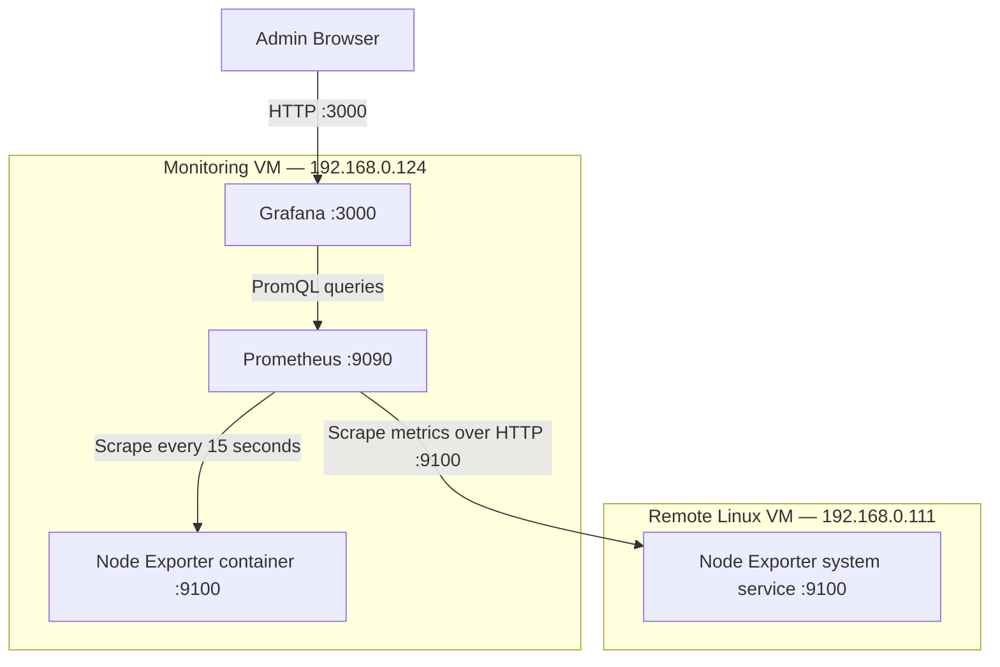

# Monitoring Architecture

This project monitors two independent Linux virtual machines.

## Components

- **Grafana** displays dashboards and manages alerting.
- **Prometheus** collects and stores time-series metrics.
- **Node Exporter on VM 1** exposes metrics from the monitoring host.
- **Node Exporter on VM 2** exposes metrics from the remote Linux host.
- **Prometheus scrape interval:** 15 seconds.

The IP addresses shown are specific to the current lab environment.
Replace them with the appropriate addresses when deploying the project
in another environment.
